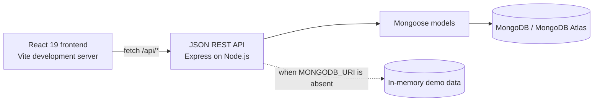

# HabitFlow Architecture

## 1. Project Overview

HabitFlow is a web application for tracking habits during a 75-day consistency challenge. Users create daily or selected-weekday habits, see what is scheduled today, record or undo completions, review streaks and reports, and archive habits while preserving their completion history.

The application addresses three practical problems: making today's commitments easy to find, measuring consistency against each habit's actual schedule, and retaining useful progress history without keeping paused habits in the active dashboard. The challenge duration is reflected in dashboard and report calculations; it is not a separate challenge-management service.

## 2. Technology Stack

| Layer | Technologies used |
| --- | --- |
| Frontend | React 19, JavaScript, Vite 6, CSS |
| Frontend icons | `lucide-react` |
| Backend runtime and framework | Node.js, Express 4 |
| Database and ODM | MongoDB, including Atlas as a deployment option, and Mongoose 8 |
| Authentication support | `bcryptjs` for password hashing and comparison |
| Configuration and cross-origin requests | `dotenv`, `cors` |
| API communication | JSON over HTTP using the browser `fetch` API |

Frontend dependencies and build scripts are in `Frontend/package.json`. Backend dependencies and scripts are in the root `package.json`. The current frontend uses lightweight History API handling in `Frontend/src/App.jsx`; React Router is not installed. The Express handlers are defined in `backend/server.js`; separate route and controller modules are not present.

## 3. High-Level Architecture

The normal persistent-data path is React frontend → REST API → Express backend → Mongoose models → MongoDB. MongoDB is optional for local demonstration: without `MONGODB_URI`, the same Express process exposes an in-memory implementation of the API, and its data resets when the process restarts.

During frontend development, `Frontend/vite.config.js` proxies `/api` requests to the backend on port 5000. The frontend API wrapper in `Frontend/src/api.js` uses `/api` by default and can be given another base URL with `VITE_API_BASE_URL`.

## 4. Application Flow

1. **Login or registration:** the frontend submits credentials or profile data to the authentication endpoints. On success it stores the returned user's ID in `localStorage` and navigates to the dashboard.
2. **Dashboard loading:** `App.jsx` requests the user, habits, history, and report together with `Promise.all`. The backend returns JSON; the UI derives today's active, scheduled habits from the returned habit list.
3. **Habit completion:** the user selects Complete. The frontend sends the habit ID and user ID; the backend checks habit ownership and schedule, then inserts one completion log for the date. Undo calls the matching delete endpoint.
4. **Progress refresh:** after a successful completion, undo, habit change, archive action, or restore, the frontend reloads its data and renders the returned streak and report values without a full-page reload.
5. **Reports:** the report view displays challenge progress, per-habit performance, a seven-day overview, streaks, and recent activity from `/api/reports/:userId`.

The current in-app views are selected through React state. Login and registration use URL paths; the other dashboard sections are view states rather than a full client-side router.

## 5. Database Design

| Model | Important fields | Relationship and purpose |
| --- | --- | --- |
| `User` | `name`, unique validated `email`, `passwordHash`, routine times, optional `photo`, `challengeStartDate`, timestamps | One profile owns many habits and completion logs. `passwordHash` is excluded from ordinary Mongoose query results. |
| `Habit` | `userId`, `name`, `icon`, `scheduleType`, `scheduledDays`, `reminderTime`, `archived`, timestamps | `userId` references the owning user. A schedule is either `daily` or `weekdays`; weekday numbers follow JavaScript's Sunday `0` through Saturday `6` convention. |
| `HabitLog` | `habitId`, `userId`, `completionDate`, `createdAt` | Each document represents a completion event and refers to both its habit and user. Logs are separate from habits so activity can be queried over time and is retained when a habit is archived. |

The models are defined in `backend/models/User.js`, `backend/models/Habit.js`, and `backend/models/HabitLog.js`. The user email has a unique constraint. `HabitLog` declares a unique compound index on `userId`, `habitId`, and `completionDate`, preventing a second completion record for the same user, habit, and date in MongoDB. The API also converts MongoDB duplicate-key errors on completion into HTTP 409.

User-specific data is associated through `Habit.userId` and `HabitLog.userId`. Habit-list, history, and report queries include a user ID filter. This association is useful for data organization, but it is not by itself authorization: see [Authentication and Login](#6-authentication-and-login).

## 6. Authentication and Login

`POST /api/auth/register` requires a name, email, and password of at least eight characters. It normalizes the email, checks for an existing account, hashes the password with `bcryptjs` using a cost factor of 10, and returns the created user without the hash. The User schema also validates and lowercases email addresses.

`POST /api/auth/login` normalizes the submitted email, loads the user's `passwordHash` explicitly, compares the submitted password with `bcrypt.compare`, and returns the user profile without the hash. Invalid credentials return HTTP 401. When MongoDB is configured, startup seeds the Ananya demo user and sample habits if needed. In memory mode, a demo user and its sample data are initialized in process memory. The login still goes through the same API comparison; the frontend does not hardcode a successful login. Demo account credentials are intentionally not repeated in this architecture document.

**Important current limitation:** the application does not create a server-side session or issue a signed token. The frontend stores only the user ID in `localStorage`; logout removes that ID. The UI gates dashboard views based on that stored ID, but there is no Express authentication middleware protecting API routes. Several mutation routes rely on a supplied user ID or habit ID, and some routes do not perform an ownership check. Therefore this is suitable as a demonstration flow, not as production-grade authentication or access control. A production deployment should authenticate every request and authorize every resource operation on the server.

The API also retains `POST /api/users` as a direct user-creation endpoint. The current frontend does not call it; registration uses `/api/auth/register` instead.

## 7. API Architecture

All routes are registered in `backend/server.js`. Requests and responses use JSON. The frontend wrapper in `Frontend/src/api.js` sends requests and raises an error when an HTTP response is not successful.

| Method and path | Purpose and behavior |
| --- | --- |
| `GET /api/health` | Returns API health and whether MongoDB is connected. Memory mode also identifies itself as `mode: "memory"`. |
| `GET /api/demo` | Returns the seeded demo user's ID, or 404 if the database-mode demo user is absent. |
| `POST /api/auth/login` | Accepts email and password; returns the user profile or 401 for invalid credentials. |
| `POST /api/auth/register` | Accepts profile details and password; returns the created profile with HTTP 201, 400 for invalid required fields, or 409 for an existing email. |
| `POST /api/users` | Direct user creation. This compatibility endpoint is not used by the current frontend. |
| `GET /api/users/:id` | Returns one user profile; returns 400 for an invalid MongoDB ID, or 404 when no user exists. |
| `PUT /api/users/:id` | Updates user fields and returns the updated profile; MongoDB mode runs schema validators. |
| `GET /api/habits?userId=:userId` | Returns that user's habits, including archived habits, with `currentStreak`, `bestStreak`, `completedToday`, and completion-date logs. MongoDB mode requires a valid user ID. |
| `POST /api/habits` | Creates a habit for a valid existing user; returns the created habit with HTTP 201. |
| `PUT /api/habits/:id` | Updates a habit while preserving its existing owner; rejects an attempted owner change with 403. |
| `PATCH /api/habits/:id/archive` | Sets `archived` to true and returns the habit. |
| `PATCH /api/habits/:id/restore` | Sets `archived` to false and returns the habit. |
| `GET /api/habits/:id/logs` | Returns completion logs for a habit, newest date first in MongoDB mode. |
| `POST /api/habits/:id/complete` | Accepts `userId` (and optionally `completionDate`); checks ownership and schedule, creates the completion, and returns updated habit statistics. Duplicate completion returns 409; a non-scheduled date returns 400. |
| `DELETE /api/habits/:id/complete/:date` | Removes the completion for the given habit and date, then returns updated statistics. |
| `GET /api/history?userId=:userId` | Returns the user's completion logs grouped by completion date, with habit name and icon populated in MongoDB mode. |
| `GET /api/reports/:userId` | Returns aggregate report values derived from that user's profile, habits, and logs; returns 400 for an invalid MongoDB ID or 404 for a missing user. |

The database and memory implementations are intended to share these endpoint shapes. In-memory responses use generated string IDs, so their identifier format is not the MongoDB ObjectId format.

## 8. Habit Scheduling and Streak Calculation

Scheduling and streak helpers are shared in `backend/utils/streak.js`. A daily habit is due every calendar day. A weekday habit is due only when the date's weekday number is included in `scheduledDays`.

The current streak counts consecutive **scheduled occurrences** with a completion. If today is a scheduled day but has not yet been completed, the current streak calculation starts with the previous date so an unfinished current-day task does not immediately erase the streak already earned. Non-scheduled dates are skipped and do not break the streak. The best streak scans from the first recorded completion to the last, counting completed scheduled occurrences and resetting only when a scheduled occurrence is missed.

The API checks the schedule before accepting a completion. The dashboard similarly shows only unarchived habits scheduled for the current day. This makes the displayed daily workload and streak rules consistent with each habit's schedule.

## 9. Morning Habit Reminder — The Twist

The reminder is derived in the frontend, not from a background scheduler. `App.jsx` filters the loaded habits to those that are active and scheduled today, then checks each habit's `completedToday` value, which the API derives from completion logs. The remaining items are shown in a morning reminder section with a View Today's Habits action. When none remain, the section changes to an all-caught-up state.

This is an in-app dashboard reminder that updates when data is loaded or refreshed. There is no timed job, browser push notification, email, or server-side reminder delivery in the current implementation.

## 10. Notifications and Alerts

The bell opens a notification popover, and its badge shows the count of currently visible alerts. The UI derives alerts from pending scheduled habits, the earliest configured reminder time among today's habits, and the current challenge day. Pending streak alerts are limited to the first few items, and the total visible alert list is capped at five.

**Ignore** dismisses one alert. **Clear All** dismisses the currently generated alerts. Dismissed alert IDs are stored in `localStorage`, scoped by user ID and today's date; the UI dismissal does not modify habits, completion logs, schedules, or streaks. Alerts are generated from current frontend data and are not persisted as notification records on the server.

## 11. Performance and Efficiency

### Present in the code

- MongoDB reads for habits, history, reports, and user data use relevant user or resource filters. History and habit queries are sorted where ordering is needed.
- The compound unique completion index supports the duplicate-completion rule. The User model declares unique email.
- Mongoose `.lean()` is used for several read paths to return plain objects where document behavior is not needed; history populates only the habit name and icon.
- The dashboard loads user, habits, history, and report concurrently with `Promise.all`, and uses React memoization for derived habit and alert lists.
- Streak rules live in reusable utility functions instead of being independently reimplemented by each API response path.
- After a mutation, the client refreshes data through API calls and updates the interface without a full-page navigation reload.
- The frontend and backend dependency lists are focused on the current application rather than a large general-purpose framework stack.

### Current trade-offs and not implemented

Report data is queried by user, but the report calculations run in JavaScript after loading the user's habits and logs; they are not MongoDB aggregation pipelines. The current implementation also loads the user's full habit/log history for several views, has no pagination or caching, and does not demonstrate a measured performance benchmark. Database indexes beyond the declared email and completion uniqueness constraints are not documented as present. Those are possible future optimizations if the dataset grows.

## 12. Best Practices

- **Separation of concerns:** model definitions and streak utilities have their own files, and the frontend API wrapper centralizes HTTP calls. Express route handlers and report logic currently live together in `backend/server.js`; separate routers/controllers are a future organization option, not a current architectural layer.
- **Input validation:** registration checks required values and minimum password length; Mongoose schemas constrain required fields, email format, schedule type, and other fields. Habit creation validates the name and user ID. Validation is not comprehensive for every endpoint or every field.
- **Password handling:** registration hashes passwords, login compares hashes, and login/register responses omit `passwordHash`. Passwords are not intended to be stored in browser storage.
- **Configuration and secrets:** backend configuration is read from environment variables using `dotenv`; `.env.example` documents variable names. Real credentials and connection strings belong in an untracked local `.env` or deployment secret store, never in this document or source control.
- **User data association:** habits and logs record `userId`, and user-specific collection queries filter by it. The current lack of request authentication and consistent ownership authorization is a known limitation, not a guarantee of secure isolation.
- **Duplicate completion prevention:** MongoDB's unique compound index is the persistent-mode guard; the in-memory mode checks existing entries before insertion.
- **Errors and loading:** the frontend has loading, busy, error, empty, toast, and confirmation states. The backend wraps asynchronous handlers and has a final JSON error handler.
- **Responsive design and accessibility:** the CSS has tablet/mobile breakpoints; forms have labels, selected controls include accessible names, completion controls use descriptive labels, and the reminder uses `aria-live`. These are implemented aids, not a claim of a completed accessibility audit.
- **Maintainability:** schedule and streak calculations are reusable, and the API wrapper avoids scattering low-level fetch handling across the UI.

## 13. Theme System

The interface supports light and dark themes. `Frontend/src/index.css` defines the main surface and text variables; `Frontend/src/theme-contrast.css` adds contrast-oriented variables and theme-specific rules. The initial theme uses the saved `habitflow-theme` value when available, otherwise it checks `prefers-color-scheme`. The selected theme is then written to `localStorage` and applied through the root `data-theme` attribute. System preference changes are not subscribed to after initial load.

Theme preference is local to the browser. User profiles, habits, completion logs, and reports are served by the backend and are not stored in browser `localStorage`.

## 14. Error Handling and Reliability

The Express async-route wrapper forwards rejected handler promises to a final error middleware. Mongoose validation errors are returned as HTTP 400; other unhandled errors return HTTP 500 with a JSON message. Route handlers also return specific status codes for invalid IDs, missing records, invalid input, duplicate email/completion, and ownership failures where those checks exist.

The frontend API helper parses JSON when possible and throws an error for non-2xx responses. Dashboard loading uses a generic error message and clears its loading state in `finally`; create/update/archive/completion operations use a shared busy flag and display operation-specific errors. Empty states and success toasts provide additional feedback. The backend's in-memory mode is intentionally ephemeral; persistent operation requires a configured MongoDB URI and a reachable database.

## 15. Trade-offs and Future Improvements

HabitFlow keeps the build practical with a single Express entry point, a small set of Mongoose models, a shared calculation utility, and a single main React application component. The memory mode makes local demonstrations possible without a database service, at the cost of losing data on restart. These choices reduce setup and navigation overhead for a time-limited project, but they are not substitutes for production controls.

**Not implemented today:** server-side sessions or signed access tokens; protected API middleware and consistent per-resource authorization; rate limiting; a comprehensive request-schema validation layer; password reset or email verification; scheduled/push/email reminders; report pagination/caching or database aggregation; and a full automated API integration/security test suite. A production evolution should prioritize authentication and authorization, then request validation, operational monitoring, and data-growth optimizations.

## 16. Architecture Summary

HabitFlow uses a small client-server design that separates the interactive React experience from the REST API and persistence layer. MongoDB models represent users, scheduled habits, and individual completion events; a shared schedule-aware utility drives streak behavior. The same core API is available through either MongoDB persistence or a clearly limited in-memory demo mode, making the project straightforward to run and explain while leaving a clear path toward stronger production security and scaling practices.

## 17. Presentation Walkthrough

1. Sign in through the login page. For a database-backed demo, the backend seeds its demo profile on startup; for a no-database demo, the in-memory profile is available. Use the credentials configured for the demo environment without putting them in public documentation.
2. Show **Today** and point out that only active habits scheduled for the current weekday appear, alongside the 75-day challenge and today's completion progress.
3. Complete one scheduled habit, then show its completed state, refreshed streak, and updated progress. Undo it once if useful to demonstrate both directions.
4. Point out current and best streaks, explaining that unscheduled weekdays are skipped rather than counted as missed occurrences.
5. Show the morning reminder with pending habits, then open the bell to demonstrate the badge and alert list. Ignore one alert or clear the visible alerts; note that this dismisses UI alerts only.
6. Archive a habit and show that it leaves today's active list but remains in Archived with its history available. Restore it to demonstrate the reversible action.
7. Open Reports to show the challenge summary, schedule-aware habit rates and streaks, seven-day overview, and recent activity.